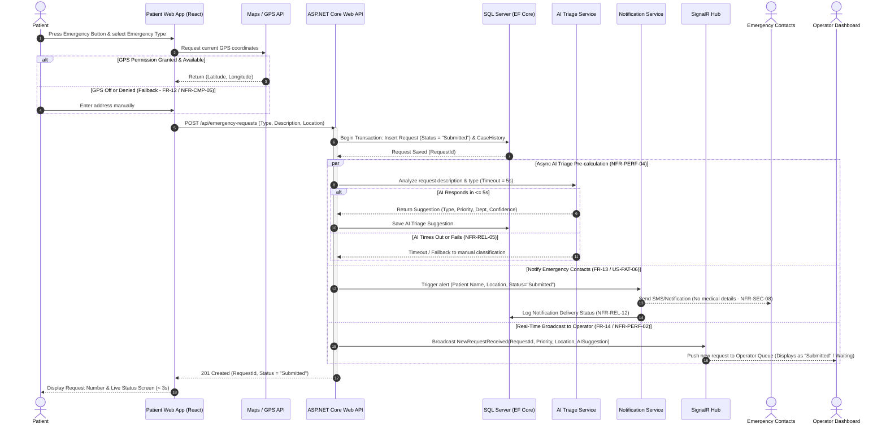
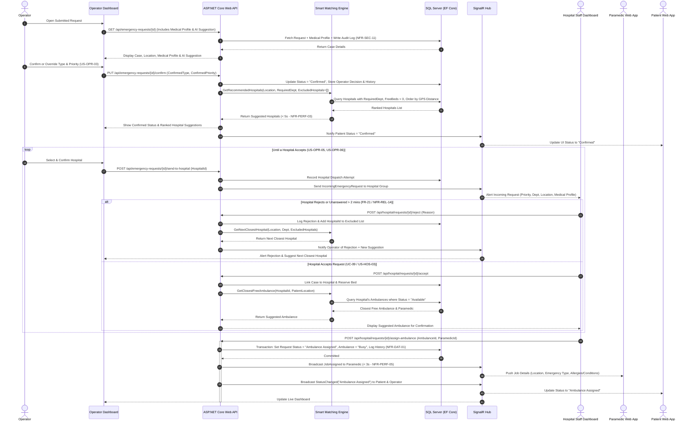
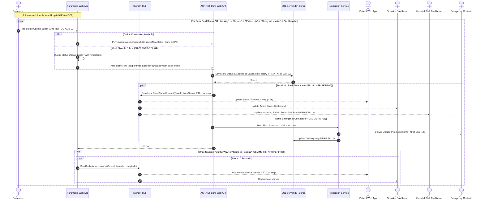
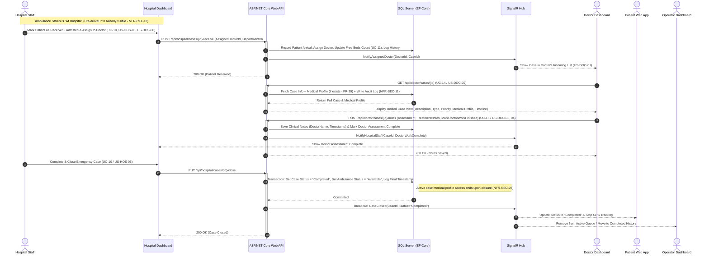
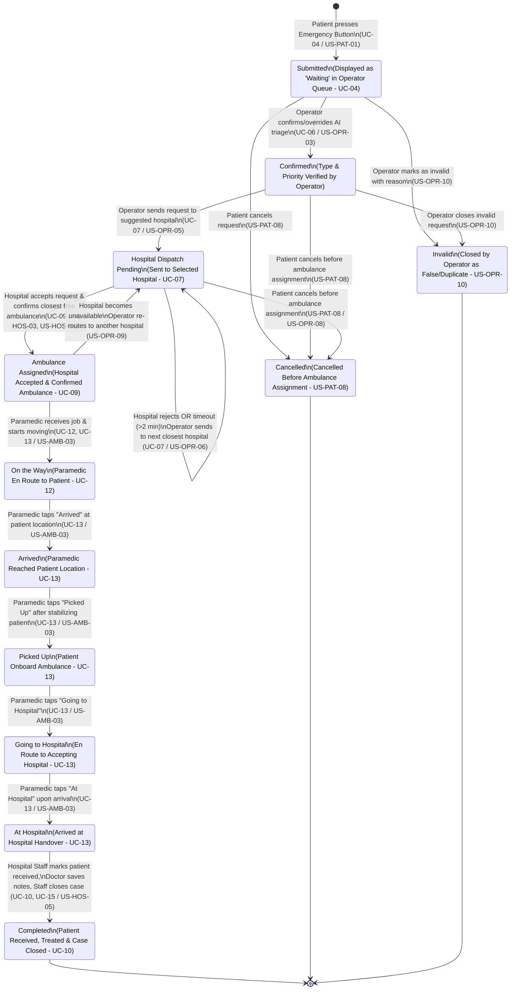

# Sequence and State Diagrams

Smart Emergency Response & Healthcare Coordination Platform

## 1. Overview

This document illustrates the runtime interactions between system components using **Sequence Diagrams** and defines the complete lifecycle of an emergency request using a **State Diagram**.

All diagrams are strictly aligned with the approved **Use Cases (`UC-01` to `UC-18`)**, **User Stories (`US-PAT-02`, `US-OPR`, `US-HOS`, `US-AMB`, `US-DOC`)**, **Functional Requirements (`FR-10` to `FR-40`)**, and **Non-Functional Requirements (`NFR-PERF`, `NFR-REL`, `NFR-DAT`)**.

### Main System Participants & Components
- **Actors:** Patient, Operator, Hospital Staff, Paramedic, Doctor, Emergency Contacts.
- **Frontend Clients:** React Web Apps (Patient App, Paramedic App, Operator/Hospital/Doctor Dashboards).
- **Backend Core:** ASP.NET Core Web API (`EmergencyController`, `HospitalController`, `ParamedicController`, `DoctorController`).
- **Real-Time Engine:** ASP.NET Core SignalR Hub (`EmergencyHub`).
- **Decision Support Services:** AI Triage Service & Smart Matching Engine (Hospital & Ambulance Recommendation).
- **External & Infrastructure:** SQL Server Database (EF Core), Maps/GPS Service, Notification Service.

---

## 2. Sequence Diagrams

### 2.1. Scenario 1: Emergency Request Submission (`UC-04`, `FR-10` to `FR-14`, `US-PAT-01`)

This diagram covers the flow when a patient presses the emergency button, captures GPS location (or enters a manual address fallback), stores the request in SQL Server before confirming (`NFR-REL-03`), triggers AI triage preparation, notifies emergency contacts (`NFR-REL-12`), and pushes the request live to the Operator dashboard within 3 seconds (`NFR-PERF-01`, `NFR-PERF-02`).

---

### 2.2. Scenario 2: Request Review, Hospital Selection & Ambulance Assignment (`UC-06`, `UC-07`, `UC-09`, `FR-17` to `FR-27`)

This diagram illustrates the human-in-the-loop review by the Operator (`US-OPR-02`, `US-OPR-03`), smart hospital recommendation and rejection loop (`US-OPR-05`, `US-OPR-06`), Hospital Staff acceptance (`US-HOS-03`), and closest free ambulance + paramedic assignment (`US-HOS-04`, `US-AMB-02`).

---

### 2.3. Scenario 3: Live Location Tracking & Status Updates (`UC-05`, `UC-12`, `UC-13`, `FR-15`, `FR-16`, `FR-31` to `FR-37`)

This diagram shows the Paramedic executing the job (`US-AMB-03`, `US-AMB-04`), streaming live GPS coordinates via SignalR (`NFR-PERF-06`), handling weak connections (`FR-36`, `NFR-REL-11`), and sending non-medical status updates to Emergency Contacts (`FR-35`).

---

### 2.4. Scenario 4: Hospital Reception, Doctor Assessment & Case Closure (`UC-10`, `UC-14`, `UC-15`, `FR-28` to `FR-30`, `FR-38` to `FR-40`)

This diagram covers hospital handover once the ambulance reaches the hospital (`At Hospital`), assigning the case to a Doctor (`US-HOS-06`), viewing the medical profile and recording treatment notes (`US-DOC-01` to `04`), closing the case (`US-HOS-05`), releasing the ambulance, and revoking temporary medical data access (`NFR-SEC-07`).

---

## 3. Emergency Request State Diagram

This State Diagram models the complete lifecycle of an **Emergency Request** entity in the database, strictly adhering to the status names defined in **`US-PAT-02`**, **`US-PAT-08`**, **`US-OPR-06`**, **`US-OPR-08`**, and **`US-OPR-10`**.

### 3.1. State Diagram (`Mermaid stateDiagram-v2`)

---

### 3.2. State Transitions & Consistency Reference Table

To ensure 100% traceability across the ERD, APIs, Use Cases, and User Stories, the table below maps every state transition, triggering actor, and business rule:

| # | Current State | Event / Trigger | Next State | Triggered By | Guard Condition / Business Rule | Related Requirement |
|---|---|---|---|---|---|---|
| 1 | *(Initial)* | Submit Emergency Request | `Submitted` *(Waiting)* | Patient | GPS captured or manual address entered; saved in DB first. | `UC-04`, `US-PAT-01`, `FR-14` |
| 2 | `Submitted` | Review & Confirm Priority | `Confirmed` | Operator | Operator confirms or overrides AI triage suggestion. | `UC-06`, `US-OPR-03`, `FR-18` |
| 3 | `Submitted` / `Confirmed` / `PendingHospital` | Cancel Request | `Cancelled` | Patient / Operator | Allowed **only** before status reaches `Ambulance Assigned`. | `US-PAT-08`, `US-OPR-08` |
| 4 | `Submitted` / `Confirmed` | Mark as Invalid | `Invalid` | Operator | Reason must be recorded (false or duplicate request). | `US-OPR-10` |
| 5 | `Confirmed` | Send Request to Hospital | `PendingHospital` | Operator | Hospital has required department and free beds. | `UC-07`, `US-OPR-05`, `FR-20` |
| 6 | `PendingHospital` | Reject Request / Timeout | `PendingHospital` | Hospital Staff / System | Rejecting hospital is excluded; next closest GPS hospital suggested. | `UC-07`, `US-OPR-06`, `FR-21`, `NFR-REL-14` |
| 7 | `PendingHospital` | Accept & Confirm Ambulance | `Ambulance Assigned` | Hospital Staff | Hospital has free bed + free paramedic; ambulance marked `Busy`. | `UC-09`, `US-HOS-03`, `US-HOS-04`, `FR-27` |
| 8 | `Ambulance Assigned` | Update Status to En Route | `On the Way` | Paramedic | Paramedic taps status button; live GPS sharing starts. | `UC-12`, `UC-13`, `US-AMB-03`, `FR-33` |
| 9 | `On the Way` | Update Status at Scene | `Arrived` | Paramedic | Paramedic reaches patient coordinates; contacts notified. | `UC-13`, `US-AMB-03`, `FR-33`, `FR-35` |
| 10 | `Arrived` | Update Status on Boarding | `Picked Up` | Paramedic | Patient is onboard the ambulance. | `UC-13`, `US-AMB-03`, `FR-33` |
| 11 | `Picked Up` | Start Transit to Hospital | `Going to Hospital` | Paramedic | Ambulance navigates back to its home hospital. | `UC-13`, `US-AMB-01`, `US-AMB-03` |
| 12 | `Going to Hospital` | Arrive at Hospital | `At Hospital` | Paramedic | Ambulance arrives at hospital entrance. | `UC-13`, `US-AMB-03`, `FR-33` |
| 13 | `At Hospital` | Receive Patient & Close Case | `Completed` | Hospital Staff *(with Doctor notes)* | Patient admitted, Doctor notes saved, Ambulance freed (`Available`), temporary medical access revoked. | `UC-10`, `UC-15`, `US-HOS-05`, `NFR-SEC-07` |
